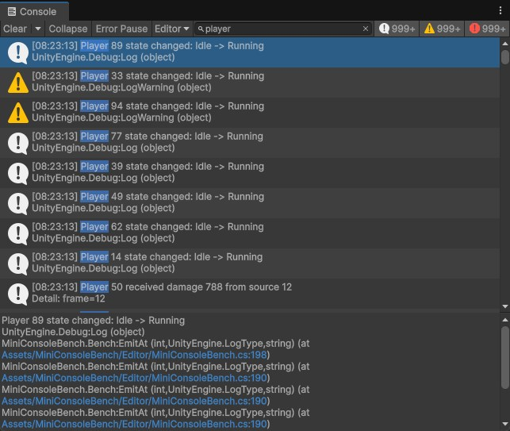
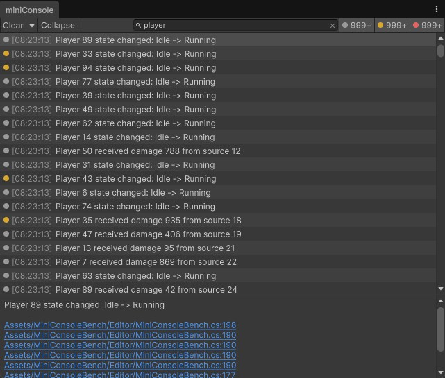

# miniConsole

[](https://github.com/Atori708/miniConsole/releases)

[](Packages/com.atori708.miniconsole/LICENSE.md)
[](README.ja.md)

A simple Console window for Unity that keeps only the features you actually need from the built-in Console.

| Console (built-in) | miniConsole |
|---|---|
|  |  |

Open it from `Window > General > miniConsole`.

## Differences from the built-in Console

- **A Console with only the essentials**
- **Each log entry takes a single line**, so many more logs fit on screen at once
- **Log details are kept minimal.** The stack trace shows only "file name:line number", so you can jump straight to the code by clicking a link
- **Features of the built-in Console that miniConsole does not have**
  - Only Editor logs are supported (logs from connected Players, such as devices, are not shown)
  - Error Pause is intentionally not supported, as it was judged unnecessary

## Installation

Open `Window > Package Management > Package Manager`, click `+` → `Install package from git URL...`, and enter:

```
https://github.com/Atori708/miniConsole.git?path=Packages/com.atori708.miniconsole
```

## Using a custom logger

Add `[HideInCallstack]` to your logger's wrapper methods. Their frames are then skipped, and the caller is shown as the log's location.

```csharp
using UnityEngine;

public static class MyLog
{
    [HideInCallstack]
    public static void Info(string message) => Debug.Log(message);
}
```

## License

[MIT](Packages/com.atori708.miniconsole/LICENSE.md)
